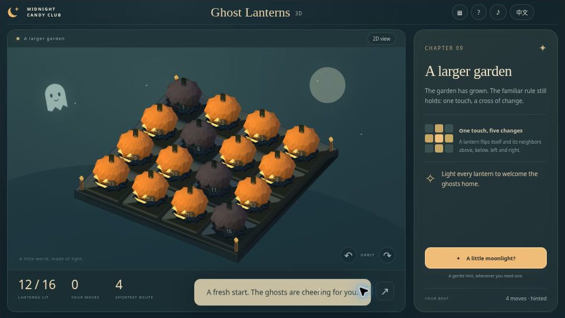
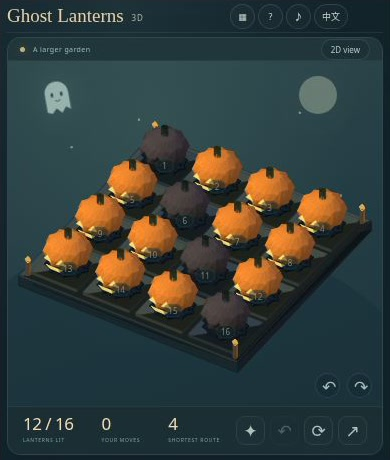

[English](README.md) · [简体中文](README.zh-CN.md) · [Español](README.es.md) · [Português (Brasil)](README.pt-BR.md) · [日本語](README.ja.md)

# Ghost Lanterns 3D — Quebra-cabeça Lights Out de Halloween

🎃 Um toque pode iluminar um cantinho inteiro da noite. Ghost Lanterns 3D leva a lógica de Lights Out para um pequeno jardim de abóboras. Inverta as luzes, acompanhe os laços violetas e receba os fantasmas em casa com doze desafios preparados e um jardim diário.

**[Jogar agora](https://halloween-3d.crazy3d.org/)** · [Ver os 12 jogos de Halloween](https://github.com/AshinTop/halloween-games) · [⭐ Dar uma estrela no GitHub](https://github.com/AshinTop/halloween-3d)

O README está disponível em cinco idiomas. A **interface do jogo oferece apenas inglês e chinês simplificado**.



## O que torna este jogo especial

- Doze jardins de campanha em tabuleiros 3×3 e 4×4; a meta é acender todas as lanternas.
- Pares de almas apresentados na fase 5 acrescentam uma ligação a determinados movimentos.
- Cenário geométrico 3D com luz e câmera giratória, alternativa 3D por software e tabuleiro plano opcional.
- Desfazer, reiniciar e pedir dicas de uma solução com o menor número de cliques.
- Desafios diários por UTC, links do tabuleiro inicial, recordes locais, sinos opcionais e movimento reduzido.

## Como jogar

Clique em uma lanterna para inverter seu estado e o das vizinhas de **cima, baixo, esquerda e direita**. As acesas apagam; as apagadas acendem. Cantos e bordas têm menos vizinhas comuns. Você vence quando todo o jardim está iluminado, sem cronômetro ou limite de jogadas.

A partir da fase 5, marcas violetas indicam pares de almas. **Clicar diretamente** em uma integrante também inverte a parceira uma vez. Uma lanterna afetada por vizinhança não transmite o efeito. Se a parceira já estiver entre as vizinhas atingidas, ela ainda muda só uma vez.

Desfazer restaura a posição anterior. Hint calcula o próximo passo de uma solução mínima para o tabuleiro atual; a referência de menor rota corresponde à posição inicial. Todos os jardins da campanha têm solução. Os diários são criados com movimentos válidos a partir de um tabuleiro resolvido.

## Controles

| Ação | Como fazer |
| --- | --- |
| Inverter uma lanterna | Clique, toque ou **Enter / Espaço** no botão em foco |
| Escolher uma lanterna | Setas com o jardim em foco |
| Desfazer, reiniciar, dica | **U / R / H** ou os botões correspondentes |
| Girar o jardim | Botões de câmera à esquerda e à direita quando exibidos |
| Usar tabuleiro plano | Alternância de visualização |
| Escolher jardim, diário ou compartilhar | Botões correspondentes no jogo |

## Um pouco de estratégia

Observe toda a cruz alterada, não apenas a luz que deseja acender. Apagar uma lanterna por um momento pode preparar a última jogada. Clicar duas vezes na mesma lanterna restaura o tabuleiro; muitas repetições sugerem que vale repensar a rota. O laço de almas responde ao clique direto, não a toda luz que muda.

## Progresso e links de desafios

Progresso da campanha, sessão atual da campanha, preferências, melhores resultados e registros de uso de dicas ficam no navegador. Não há conta nem ranking online. O desafio diário usa a **data UTC**, que pode ser diferente da data local.

Este [jardim com um par de almas](https://halloween-3d.crazy3d.org/#p=v1.3.26.0-8) inclui o tabuleiro inicial, seu tamanho e os pares. Compartilhar não envia seus movimentos atuais nem um replay; a outra pessoa recebe o mesmo problema para resolver.

## Capturas de tela e vídeo de apresentação



Captura real em um iframe compacto. Ela mostra o layout em uma janela pequena, não um teste em celular físico.

[Player de vídeo e transcrição](https://halloween-3d.crazy3d.org/intro.html) · [Baixar o MP4](docs/media/intro.mp4)

A **apresentação de 24 segundos, sem áudio**, combina capturas reais e legendas. É um passeio visual, não uma partida gravada continuamente nem uma demonstração sonora.

## Perguntas frequentes

### Posso jogar sem WebGL?

Sim. Quando não há contexto WebGL, Canvas projeta a geometria 3D real usando a mesma câmera. Também existe um tabuleiro 2D completo; uma falha do renderizador pode ativar essa vista plana.

### A dica segue sempre um roteiro fixo?

Não. Ela resolve o tabuleiro atual e encontra uma rota mínima, inclusive depois das suas tentativas ou de desfazer jogadas.

### O visual WebGL foi verificado?

A revisão no navegador cobriu as vistas 3D por software e plana em um ambiente sem WebGL. Isso não comprova o visual em aparelhos físicos nem uma taxa de quadros da GPU.

## Executar localmente e incorporar

Inicie um servidor HTTP na raiz do repositório:

```sh
python3 -m http.server 4173
```

Abra **http://localhost:4173/**. Não é preciso compilar nem instalar dependências. Use HTTP: `file://` pode bloquear módulos JavaScript.

Execute as verificações incluídas com Node:

```sh
npm test
```

Os testes cobrem vizinhança, pares não recursivos, reversibilidade, soluções da campanha, mínimos em 3×3, links inválidos e 365 desafios diários. A projeção também é verificada quanto a giro, redimensionamento, janelas estreitas e ordem de profundidade.

```html
<iframe src="https://halloween-3d.crazy3d.org/?embed=1"
  title="Ghost Lanterns 3D"
  style="display:block;width:100%;height:540px;border:0"
  allow="fullscreen" allowfullscreen></iframe>
```

As janelas revisadas incluem **960×540**, **390×460**, **390×300** e **844×340**. O tamanho do próprio iframe define o layout; `?embed=1` solicita a apresentação compacta. Canvas e módulos JavaScript são necessários; WebGL é opcional. O som começa após interação e pode ser desligado.

Veja [EMBEDDING.md](EMBEDDING.md) para tamanho, armazenamento, foco e permissões. Meça a altura disponível após a barra do site principal.

## Mais pequenas aventuras de Halloween

- **[Ghostkeeper Maze 3D](https://halloween-haunted-maze.crazy3d.org/)** · [Código](https://github.com/AshinTop/halloween-haunted-maze) — Explore corredores em primeira pessoa e resgate três espíritos-lanterna.
- **[Pumpkin 2048](https://halloween-2048.crazy3d.org/)** · [Código](https://github.com/AshinTop/halloween-2048) — Junte abóboras numeradas e resolva desafios com casas-alvo.
- **[Witch’s Potion Match](https://halloween-potion-match.crazy3d.org/)** · [Código](https://github.com/AshinTop/halloween-potion-match) — Troque ingredientes, forme cascatas e acenda as velas da receita.
- **[Moonlit Mirrors](https://halloween-mirror-hearts.crazy3d.org/)** · [Código](https://github.com/AshinTop/halloween-mirror-hearts) — Guie dois fantasmas ao mesmo tempo por tabuleiros espelhados.

## Créditos e apoio

Criado para **AshinTop** e **Midnight Candy Club**, com design, programação e revisão conduzidos por pessoas com auxílio de IA. Arte e sons sintetizados originais do projeto. Dispensa conta remota; a hospedagem pode adicionar scripts ou registros de acesso.

Gostou? **[Deixe uma estrela no GitHub](https://github.com/AshinTop/halloween-3d)**. Para relatar problemas, inclua navegador, tamanho do iframe, link e passos para reproduzi-los.
